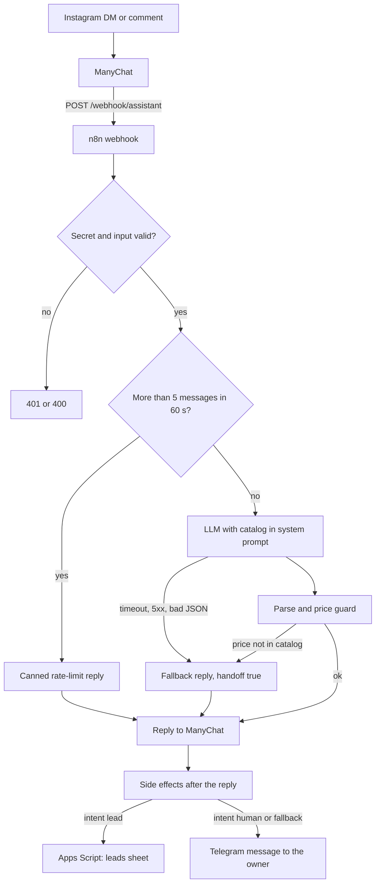

# ig-assistant

Instagram DM assistant for a small clothing store. ManyChat owns the Instagram channel and forwards
each message to an n8n webhook. n8n asks an LLM (Groq by default) to answer from the store catalog,
checks the answer with deterministic guards and returns `{reply, intent, handoff}`. Leads go to a
Google Sheet and human handoffs go to the owner on Telegram. The request/response contract has no
Instagram-specific fields, so a WhatsApp adapter can be added in front of the same workflow later.

The store ("Tienda Demo Ropa") and its catalog are fictional. This is a local demo: it has not been
deployed, connected to a real ManyChat account or used with real customers.

## Architecture



The reply is sent before the side effects run, so a slow or failing sheet or Telegram never delays the customer.

## Contract

Request: `POST /webhook/assistant` with header `X-Assistant-Secret: <ASSISTANT_SECRET>` (missing or wrong: 401).

```json
{"channel": "instagram", "contact_id": "123", "username": "ana", "message": "¿Cuánto sale la remera básica?"}
```

Response 200:

```json
{"reply": "La remera básica de algodón cuesta $12.900 y hay talles S, M, L y XL.", "intent": "faq", "handoff": false}
```

`intent` is one of `faq`, `lead`, `human`, `other`. An empty message gets 400. Customer-facing text is in Spanish.

## Guards and why

- **Price guard.** The model must not quote prices that are not in the catalog. Any price in a reply
  (`$N`, `N pesos/ARS`, numbers with thousands separators or 4+ digits) is checked against the catalog;
  a mismatch replaces the reply with a canned handoff message. Days and opening hours do not trigger it.
- **Fallback in under 5 s.** ManyChat external requests time out after a few seconds. The LLM call has its own
  timeout (`LLM_TIMEOUT_MS`, default 3000). Timeout, 5xx, non-JSON or an invalid `intent` all end in a canned reply with `handoff: true`.
- **No user text in the system prompt.** The system prompt holds only the catalog and rules; the customer message is a separate
  `user` message. The LLM has no tools: n8n, not the model, decides side effects from `intent`.
- **Rate limit.** More than 5 messages from one `contact_id` in 60 s get a canned reply and the LLM is not called.
- **Lead dedup.** One lead row per contact per day. n8n claims the contact before posting and releases the claim if the post fails;
  Apps Script also upserts by `contact_id` and day.

## Run locally

Requirements: Docker. For tests also Python 3.

    cp .env.example .env     # fill in values (the file is git-ignored)
    docker compose up        # n8n on http://localhost:5678, workflow imported and activated at startup

    curl -X POST http://localhost:5678/webhook/assistant \
      -H "Content-Type: application/json" \
      -H "X-Assistant-Secret: <your ASSISTANT_SECRET>" \
      -d '{"channel":"instagram","contact_id":"demo-1","username":"ana","message":"¿Tienen jeans en talle 42?"}'

A real answer needs a valid `GROQ_API_KEY`; without one you get the fallback reply. `LLM_BASE_URL`, `TELEGRAM_API_BASE`
and `LEADS_URL` are configurable so they can point at fakes.

## Tests and report

    python -m venv .venv && .venv/Scripts/pip install -r requirements-dev.txt   # Windows; use .venv/bin on Linux/macOS
    .venv/Scripts/python -m pytest

The 18 tests are end-to-end: they start the real n8n container with docker compose and replace the LLM, Telegram and the
leads sink with one fake HTTP server. A full run rewrites [reports/e2e-report.md](reports/e2e-report.md) (date, commit,
n8n image, one row per failure mode, result, duration). Runs that select a subset do not overwrite it.

## Editing the catalog

The catalog lives in `catalog/catalog.json` and is baked into the workflow JSON. After editing it (or `n8n/code/*.js`), regenerate and restart:

    python n8n/build_workflow.py
    docker compose up --force-recreate

`n8n/workflows/assistant.json` is generated; do not edit it by hand.

## What is proven and what is not

Proven by the E2E suite (see the report): authentication, input validation, the price guard, every LLM failure path, the 5 s fallback,
lead dedup, Telegram handoff, tolerance to a failing sheet or Telegram, the rate limit and the prompt structure.

Not proven: how a real model behaves (run `eval/live_eval.py` with your own key; it writes `reports/live-eval.md`, which is generated by the user and is
not in the repo until then), the Apps Script deployment, and every ManyChat step. Those need real accounts.

## Limitations

- Rate limit and lead dedup state live in n8n workflow static data. Concurrent executions for the same contact can lose updates
  (last write wins). Apps Script's upsert under a lock covers the leads case; the rate limit can be exceeded under a burst.
- The price guard does not catch prices spelled out in words ("doce mil").
- Instagram only allows replying within 24 hours of the customer's last message. The bot can answer, not send proactive follow-ups.
  Proactive follow-ups are what the future WhatsApp adapter would add.

## Docs

- [docs/manychat-setup.md](docs/manychat-setup.md): connect Instagram, comment automation, External Request, manual curl tests.
- [apps-script/README.md](apps-script/README.md): leads sheet web app (deploy, secret, redirect note).
- [reports/e2e-report.md](reports/e2e-report.md): latest E2E run.
- `reports/live-eval.md`: live eval against the real LLM, generated by the user with a real key.
